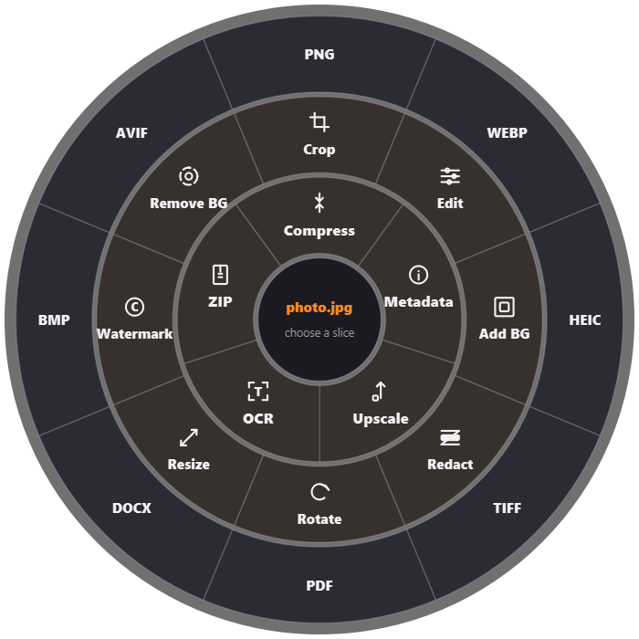
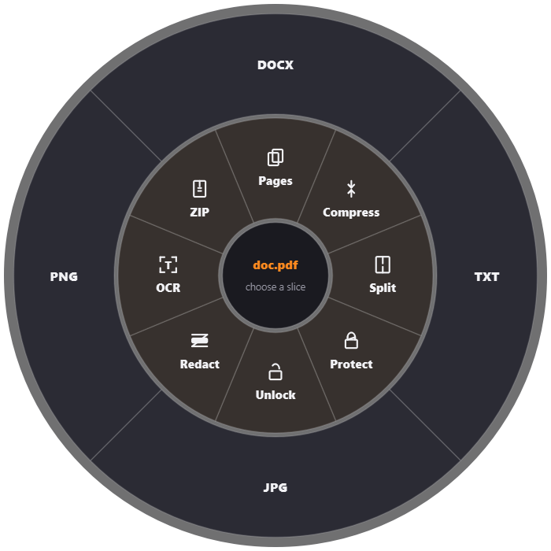
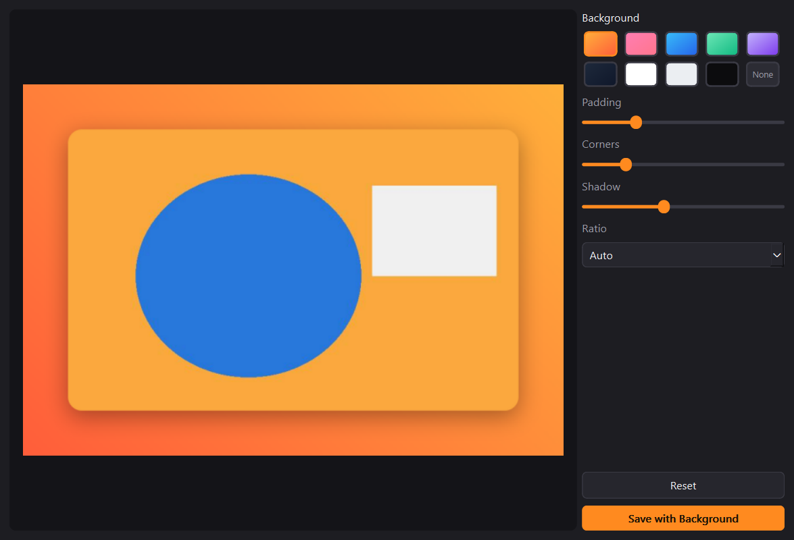
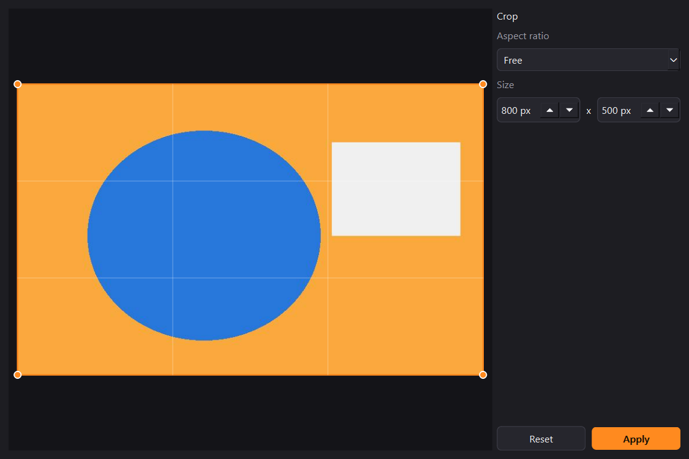

# Tangerine for Windows

A Windows take on the Tangerine app for Mac: **hold a modifier key, drag a file, and a radial menu opens at your cursor.** Drop the file on a slice to convert it or run a tool on it. Everything runs locally, nothing is uploaded.

<p align="center">
  
  
</p>

## Install

1. Download `Tangerine-Setup.exe` from the [latest release](../../releases/latest).
2. Run it and press **Install**. No admin rights needed. Keep **Start Tangerine when Windows starts** ticked and Tangerine launches itself after every reboot, so you never open it by hand.
3. Look for the tangerine icon near the clock.

Windows may warn about an unknown publisher because the installer is not code signed: choose **More info > Run anyway**.
Uninstall from **Settings > Apps > Tangerine**.

## Use

1. Hold **Ctrl + Shift** (change it in Settings: Alt, Ctrl + Alt) and start dragging a file in Explorer.
2. The radial menu appears under the cursor. Move the file onto a slice and release.
3. The result is saved next to the original, or in the output folder from Settings.

Also available without the trigger: drop files on the Tangerine window, or use the tray menu **Menu from clipboard** (files, an image or text).
Select several files to get the **Combine** ring (merge PDFs, images into one PDF, ZIP all).
Tray menu: **Recent**, **Undo last operation** (moves results to the Recycle Bin), **Settings**.

| File | Slices |
| --- | --- |
| Image | **Convert:** PNG, WEBP, HEIC, TIFF, PDF, DOCX, BMP, AVIF, JPG. **Edit:** Crop, Edit, Add BG, Redact, Rotate, Resize, Watermark, Remove BG (plain backgrounds). **Utility:** Compress, Metadata, Upscale 2x, OCR, ZIP |
| PDF | **Convert:** DOCX, TXT, JPG, PNG. **Tools:** Pages (reorder, rotate, delete, extract), Compress, Split, Protect, Unlock, Redact (text), OCR, ZIP |
| DOCX, TXT, Markdown | PDF, DOCX or TXT, ZIP |
| Video | MP4, WEBM, MKV, GIF, MP3, Trim, Compress, Mute, ZIP |
| Audio | MP3, WAV, FLAC, OGG, M4A, Trim, Compress, ZIP |
| ZIP, folders, anything else | Extract, ZIP |

<p align="center">
  
  
</p>

Settings cover the trigger key, output folder, quality (JPG/WEBP/HEIC/AVIF, compress, PDF DPI), moving the original to the Recycle Bin after converting, start with Windows, and which slices are shown and in what order.

### Notes

- Windows does not reveal dragged file paths during a system-wide drag, so the overlay opens when the trigger is detected and reads the files when you move onto it.
- OCR uses the engine built into Windows and needs an OCR language installed (normally your display language).
- Video and audio use ffmpeg. A system ffmpeg is used if present, otherwise the one bundled through `imageio-ffmpeg`.
- DOCX to PDF uses a simplified renderer (text, headings, bold/italic, lists, tables), not Word. Remove BG works on plain backgrounds only, it is not AI based.

## Run from source

Python 3.11+ on Windows.

```
python -m venv .venv
.venv\Scripts\pip install -r requirements.txt
.venv\Scripts\python main.py
```

`--hidden` starts in the tray only. Starting a second copy just brings up the running one.

## Build the installer

```
powershell -ExecutionPolicy Bypass -File packaging\build.ps1
```

This builds the app with PyInstaller, self-tests it, and produces `dist\Tangerine-Setup.exe`. Plan for about 1 GB of free disk space.

## Tests

```
python tests/test_backend.py        # every converter and tool
python tests/test_ui.py             # builds every window offscreen, screenshots in tests/_out/ui
python tests/test_trigger.py        # trigger state machine and menu drop handling
python main.py --selftest out.txt   # checks the bundled libraries, also works inside the built exe
```

A ready CI workflow is in `packaging/github-ci.yml` (tests on every push, installer build on demand or for a tag). To enable it, copy it to `.github/workflows/ci.yml`; pushing a workflow file needs the `workflow` scope (`gh auth refresh -s workflow`).

## Layout

```
main.py                 entry point
tangerine/
  main.py               tray, trigger, action runner
  registry.py           file type -> radial menu slices
  trigger.py            global Ctrl+Shift + drag detection (pynput)
  converters/           image, pdf, text, word, archive, media (ffmpeg)
  tools/                crop, add_bg, edit, redact, resize, watermark, ocr, pdf_tools, ...
  ui/                   radial menu, drop window, tool windows, settings, progress
packaging/              PyInstaller spec, installer, uninstaller, build script
tests/
```


